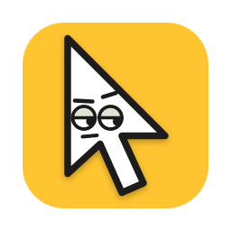
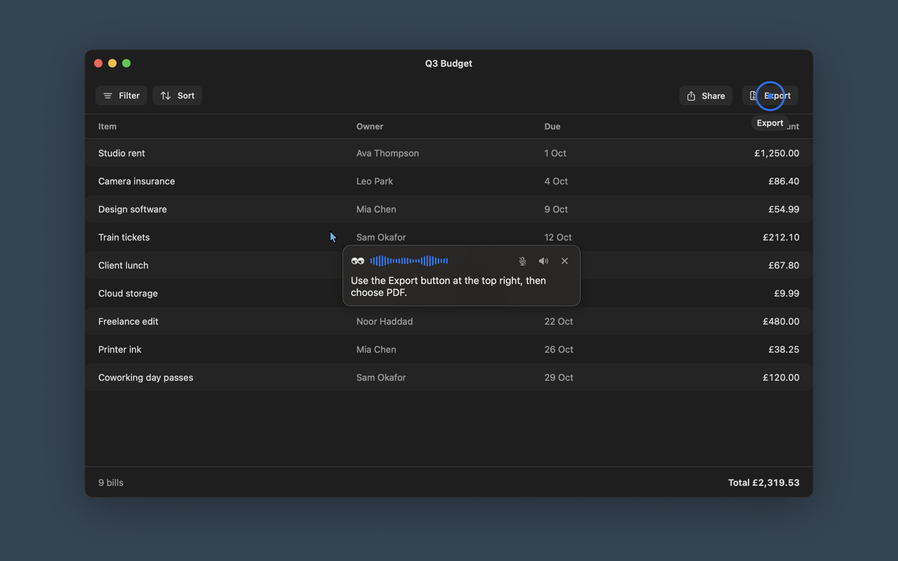
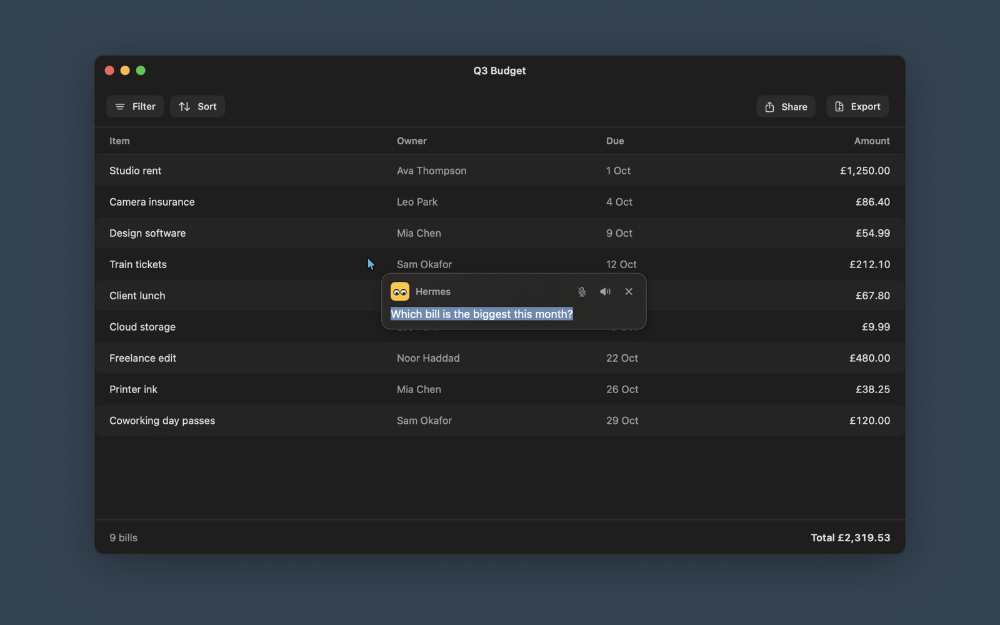
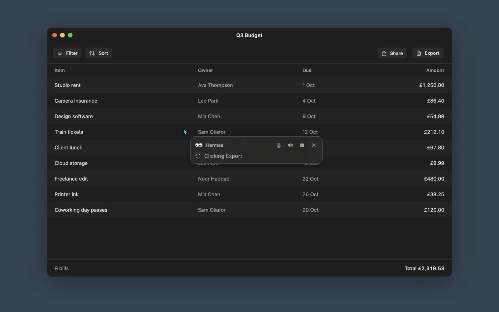
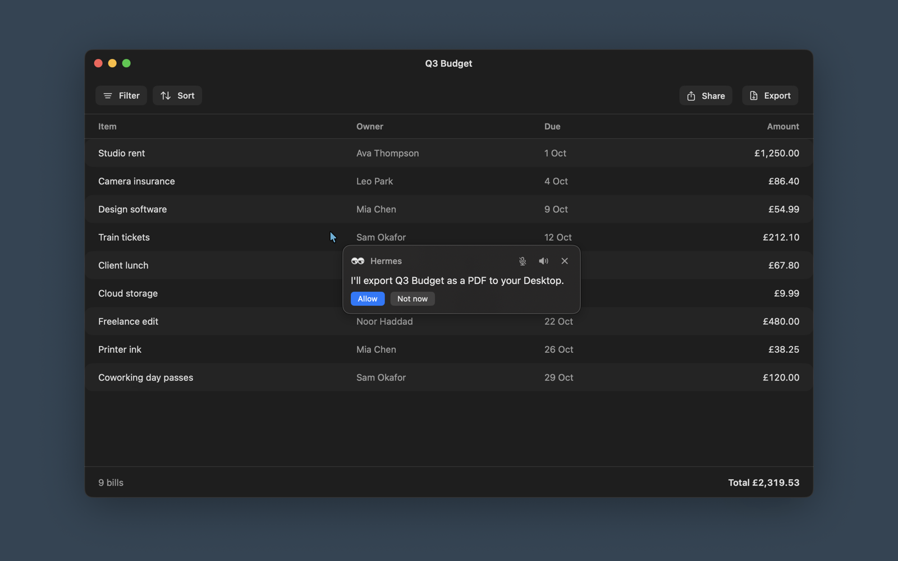
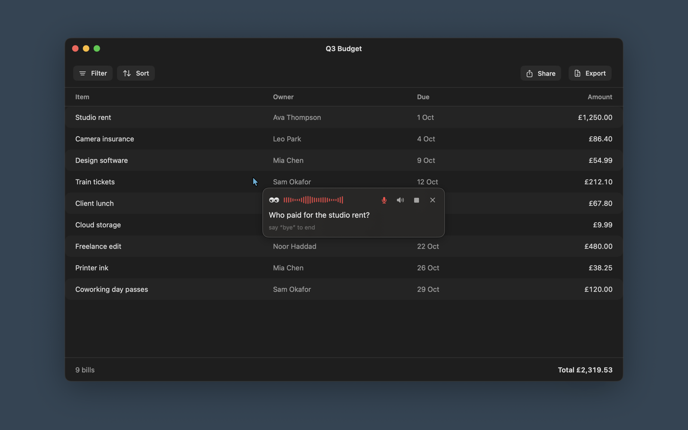
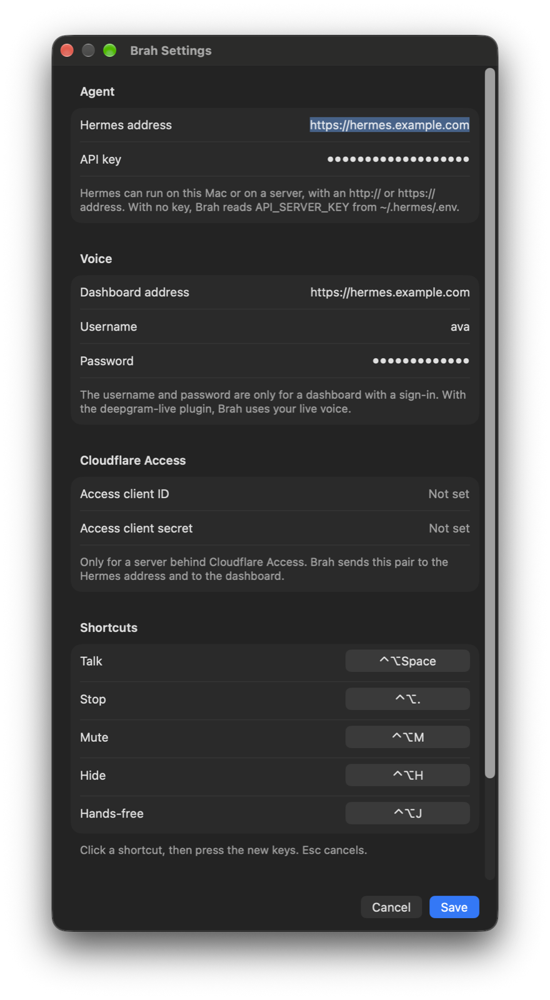
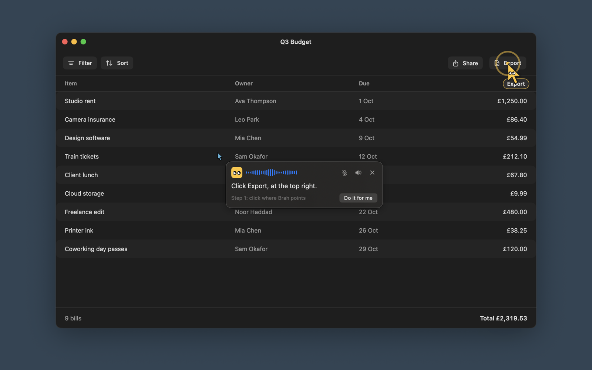
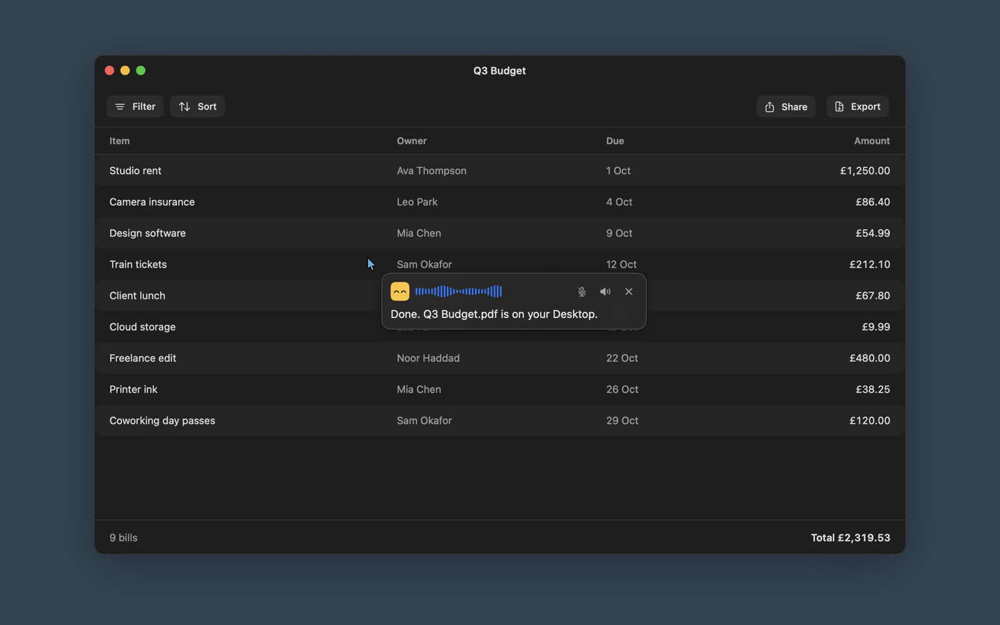

<p align="center"></p>

# Brah

> **Ho, brah.** Your mate next to the cursor.

**A voice AI assistant for macOS that sees your screen.** Hold a key or say **"Hey Brah"**, ask
about whatever is on your screen, and your own AI answers out loud and points at the thing with
its own cursor. Ask it to do the thing, and it clicks and types for you. After you say yes. Not
before. Works with Claude, Ollama and Hermes. Native app for macOS 14 or later, free for
personal use.

Brah is said *brah*, as in "ho, brah!", not *bruh*. It lives next to your mouse pointer.

**Bruh** is the face you make when the Export button was right there all along.
**Brah** is the mate who points at it.

That face is the icon: a cursor giving you the side-eye.

Brah sees, listens, talks and points. Your AI does the thinking. Pick Hermes, Claude with your
own plan or an API key, or any OpenAI-compatible server, Ollama included.



## In pictures

Fake app, fake bills, fake people. Real Brah.

| | |
|---|---|
|  |  |
| **Listening.** Hold the key and ask like you would ask a mate. Your words show as you talk. | **Typing.** Tap the key instead. For libraries and open-plan offices. |
|  |  |
| **Working.** Every step shows, so you know what it is up to. | **Asking first.** Nothing gets clicked until you say so. Brah has manners. |
|  |  |
| **Hands-free.** "Hey Brah", then just talk. "Bye" when you are done. | **Settings.** Your agent, your voice, your keys. Secrets go in the Keychain. |
|  |  |
| **Show me.** Brah's own cursor flies to the next click and waits. Click it, and Brah finds the next one. Or hit **Do it for me**. | **Done.** Happy eyes. Keep Brah waiting too long and you get the side-eye. |

## What it does

- **Sees what you see.** Each question takes a screenshot of the screen under your cursor, with
  the cursor circled. Brah keeps itself out of the picture.
- **Listens.** Hold the key and talk. Your words show up as you say them.
- **Hands-free.** Say "Hey Brah" and talk. It listens again after every answer, until you say
  "bye" or go quiet for a bit. The wake word is heard on the Mac: no audio leaves it until you say
  "Hey Brah".
- **Talks back.** The answer streams in, and the voice starts on the first sentence. Echo
  cancellation stops Brah from hearing itself, which is more than some people manage.
- **Points, with its own cursor.** A yellow Brah cursor flies from your pointer to the exact spot,
  leaves a short trail so you can follow it, and pulses there with a label. No more "top right.
  No, the other top right."
- **Marks the screen.** It circles, boxes, underlines, draws arrows and free-hand lines, the way
  a mate would on a whiteboard. The marks draw in one by one and go away on the next question.
- **Shows you, step by step.** Ask how to do something. Brah's cursor goes to the first click and
  waits. You click there, Brah looks again and goes to the next one, until the job is done. Clicks
  somewhere else do not count, so you can carry on with other things. Bored of
  clicking? **Do it for me** hands the rest to the agent, after your yes.
- **Has moods.** Its eyes listen wide open, look up when it thinks, scan while it works, go happy
  when it is done, and give you the flat "bruh" side-eye when you keep it waiting or stop it.
- **Does it for you, after a yes.** Ask it to do something on the screen. The agent says what it
  will do and waits. Click **Allow** or say "yes". Until then, its screen tools are locked. Every
  step shows in the bubble, and Stop locks them again at once.
- **Knows when to be quiet.** Talk over it and it stops. Mute, stop and close are one click or one
  key away. Every answer has a copy button too.

## Screen actions

### Claude (subscription or API key)

Brah has its own hands: `screenshot`, `click`, `type`, `key` and `scroll`. Claude Code gets them
through a small MCP server that Brah runs on `127.0.0.1`, with a new token on each run. The
Anthropic API route uses the same tools in its own loop. Brah's yellow cursor flies to each
click first, so you can see what happens.

Brah acts in auto mode: it does the task, and asks first only before a risky action, such as
send, pay, delete, publish, submit or sign in. Answer with **Allow**, **Always allow** or **Not
now**, or say yes or no. Stop cancels the rest of the task.

Clicks and typing need the Accessibility permission: System Settings > Privacy & Security >
Accessibility > Brah.

To try it, open `demo/benchmark.html` in a browser. It is a made-up app with charts, forms,
multi-step flows and a scored list of tasks, from "read a value" to "finish a four-step wizard".

### Hermes

Brah keeps the agent's hands off your screen until you say yes.

Hermes acts on the screen with its `computer_use` tool, which Hermes leaves off for the API
server. Turn it on for the API server:

```bash
hermes tools enable computer_use --platform api_server
```

Brah locks the agent's screen tools until you allow an action. The lock needs the
`screen-remote` Hermes plugin. Without it, the agent's promise to ask first is the only gate.

The lock covers screen and browser tools, not terminal commands. In one test the agent opened an
app with a terminal command instead of a click. For commands, the promise to ask first is the
only gate.

Screen actions only work with a Hermes on this Mac. A Hermes on a server would click on the
server, so Brah tells it not to.

## Run it

Needs macOS 14 or later and Xcode. Then it is two lines, brah.

```bash
BRAH_SIGN_IDENTITY="Apple Development" scripts/bundle.sh
open build/Brah.app
```

On the first run, allow Brah in System Settings > Privacy & Security for Screen Recording,
Microphone and Speech Recognition, then open Brah again. Without `BRAH_SIGN_IDENTITY` the app is
signed ad hoc, and macOS asks for Screen Recording again after each build.

| Key | Action |
|---|---|
| Hold ⌃⌥Space | Talk. Release to send |
| Tap ⌃⌥Space | Type a question. Press again to close |
| ⌃⌥. | Stop: listening, the agent and the voice |
| ⌃⌥M | Mute or unmute the voice |
| ⌃⌥H | Hide everything |
| ⌃⌥J | Hands-free: listen for "Hey Brah", or stop |
| Esc | Stop while it works, close after |

Drag the bubble by its empty space to move it. It stays there until the next question.

### Change the shortcuts

Open **Settings** from the Brah menu. Under Shortcuts, click the shortcut of an action, then
press the new keys. Esc cancels. Brah does not accept a key that another action uses, and says
so under the action. Click **Save** to use the new shortcuts.

The Settings window writes `~/.config/brah/config.json`. You can also set the shortcuts in that
file yourself, then reopen Brah:

```json
{"shortcuts": {"talk": "cmd+shift+space", "stop": "ctrl+option+.", "mute": "ctrl+option+m", "hide": "ctrl+option+h", "handsFree": "ctrl+option+j"}}
```

Modifiers: `ctrl`, `option` (or `alt`), `shift`, `cmd`. Keys: letters, digits, `space`, `return`,
`tab`, `esc`, `.`, `,`, `/`, the arrows and `f1` to `f12`. Each shortcut needs a modifier, except a
function key. A shortcut that is not valid, or that two actions share, goes back to its default,
and Brah says why in its log. The menu shows the shortcuts in use.

## Pick your AI

Open **Settings** from the Brah menu (or press ⌘,). The AI tab picks the provider:

| Provider | What you need |
|---|---|
| Claude subscription | Claude Code installed and signed in. Brah runs it with its tools off. |
| Anthropic API | An API key from console.anthropic.com. |
| OpenAI-compatible | A server address such as `http://localhost:11434/v1` (Ollama), and a key if it needs one. |
| Hermes | See below. Hermes and both Claude routes can click for you today. |

Both Claude routes start on Haiku 5.5 at medium effort. Change the model and the effort in
Settings, or the effort from the menu in the middle of a conversation. **Check** tests the key
and loads the model list. Keys go in the Keychain.

Under Responses, pick short, normal or detailed answers, and write custom instructions that
every provider gets ("Call me Rez. Use British English.").

`BRAH_PROVIDER=claude|anthropic|custom|hermes` picks a provider for one run, without a change to
the config file.

## Connect Hermes

Brah calls the Hermes API server (`/v1/chat/completions`) and streams the answer. Hermes can
run on this Mac or on a server, for example a VPS behind a Cloudflare tunnel, or a computer on
your Tailscale network. Both `http://` and `https://` addresses work.

The easy way is the Settings window: open **Settings** from the Brah menu and fill in the Hermes
address and the API key under Agent. With no address, Brah uses `http://127.0.0.1:8642`. Brah
keeps the key in your Keychain, not in a file.

Brah finds the key in this order:

1. `BRAH_HERMES_URL` and `BRAH_HERMES_KEY` in the environment.
2. The Keychain, where the Settings window saves the key.
3. `~/.config/brah/config.json`: `{"hermes": {"url": "http://127.0.0.1:8642", "key": "..."}}`
4. `API_SERVER_KEY` in `~/.hermes/.env`, with the URL `http://127.0.0.1:8642`.

### Cloudflare Access

When Hermes is behind Cloudflare Access, make a service token in Cloudflare Zero Trust. Put its
client ID and client secret in Settings under Cloudflare Access. Brah sends them as the
`CF-Access-Client-Id` and `CF-Access-Client-Secret` headers to the Hermes address and to the
dashboard. Brah keeps both in the Keychain. The environment can set
`BRAH_CF_ACCESS_CLIENT_ID` and `BRAH_CF_ACCESS_CLIENT_SECRET` instead.

## Voice

Brah talks with a voice you pick, not a robot's. The Voice tab in Settings sets who speaks:

- **Deepgram Aura:** pick a voice (Athena, Pandora, Draco and more). Use your own Deepgram key,
  or leave it empty to use the Deepgram plugin of your Hermes. It speaks while the answer
  arrives. With your own key, Brah also listens with Deepgram.
- **Groq Orpheus:** pick a voice (Autumn, Diana, Hannah, Austin, Daniel, Troy) and add your Groq
  key. It speaks a sentence at a time.
- **Mac:** free, private, and works offline. Pick any installed voice and press Play.
- **Hermes voice, else Mac:** the default, described below.

The Mac voice is also the fallback when another voice cannot speak.

**With the `deepgram-live` Hermes plugin**, Brah uses your live voice: the Aura voice, the Flux
listening model, the speed and the key terms that you set under `deepgram_live` in the Hermes
config. The plugin keeps your Deepgram key on the host and gives Brah tokens that last 30
seconds; Brah then streams to Deepgram directly, as the Hermes desktop app does.

**Without that plugin**, Brah speaks and listens with the voice of your Hermes: the speech-to-text and text-to-speech
providers you set in Hermes (Deepgram, ElevenLabs, Edge, OpenAI, local Whisper and others). When
the provider can stream, your words show while you talk and the answer is spoken while it
arrives. When it cannot, Brah sends the whole recording and speaks the whole answer.

The voice routes, and the plugin, are on the Hermes dashboard (`hermes dashboard`, port 9119 by
default).

- **A local dashboard with no sign-in:** nothing to set. Brah reads the session token that the
  dashboard gives to local pages.
- **A dashboard with a sign-in** (for example one with `dashboard.public_url`): give Brah the
  same username and password that you use for the dashboard.

Set the dashboard address, the username and the password in Settings under Voice. Brah keeps
the password in your Keychain. You can also put the address and the username in
`~/.config/brah/config.json`:

```json
{"hermes": {"voice": {"url": "http://127.0.0.1:9119", "username": "..."}}}
```

Older setups can keep `"password"` in that file too. Brah uses the Keychain password first.
Both routes use this sign-in. The environment can set `BRAH_HERMES_VOICE_URL`,
`BRAH_HERMES_USERNAME` and `BRAH_HERMES_PASSWORD` instead, and these win over the Settings
window. The menu shows which voice Brah uses.

When Brah cannot reach the Hermes voice, it uses the speech engines of macOS, with the best
installed voice for your language. The default macOS voices sound robotic. For a better one,
download a Premium or Enhanced voice in System Settings > Accessibility > Spoken Content >
System Voice > Manage Voices.

## Roadmap

1. **More providers.** The OpenAI API, the Codex subscription, and Ollama as its own choice.
2. **Clicks for every provider.** Claude does it now. Next: OpenAI-compatible servers, and
   Always allow rules that last after Brah quits.
3. **More voices.** Speech to text from Groq, OpenAI Whisper and local models. OpenAI Realtime
   for live talk.
4. **Agents.** Workflows you set up yourself, for example an onboarding guide for your team.
   Talk answers you; agents do things for you, in any app you can see.
5. **Your AI from anywhere.** Reach an agent on another computer without a tunnel to set up.
6. **History.** See past conversations and carry on with one.
7. **Setup help.** Brah finds what is missing, such as Claude Code or a local model, and helps
   you install it.
8. **App Store build.** Sandboxed: Brah keeps to seeing and pointing, and the agent acts.

## Icons

The app icon and the menu bar icon are SVG files in `Resources/icon`. After you change one, run
`scripts/icons.sh` (needs `brew install librsvg`). It makes every size macOS needs.

## Test

```bash
swift test
build/Brah.app/Contents/MacOS/Brah --ask "Where is the search field?"
build/Brah.app/Contents/MacOS/Brah --talk 5
build/Brah.app/Contents/MacOS/Brah --converse
```

`scripts/screenshots.sh` makes the pictures in `docs/screenshots` again. It runs
`Brah --demo <state>`, which draws a made-up app behind the real bubble, so no real screen gets
into a picture.

`--converse` starts a hands-free conversation as "Hey Brah" does. `--ask "..." --yes` says yes
once when the agent asks to act, as a click on Allow would. `BRAH_SNAPSHOT_PATH=/tmp/s.jpg`
saves the exact picture the agent gets.

## Licence

Free for you and your mates. Not free for your company.

[PolyForm Noncommercial 1.0.0](LICENSE.md). You can read, run and change Brah for personal and
other noncommercial use. You cannot sell it, or use it in or for a business, without a separate
commercial licence from the author. For a commercial licence, open an issue on this repository.
